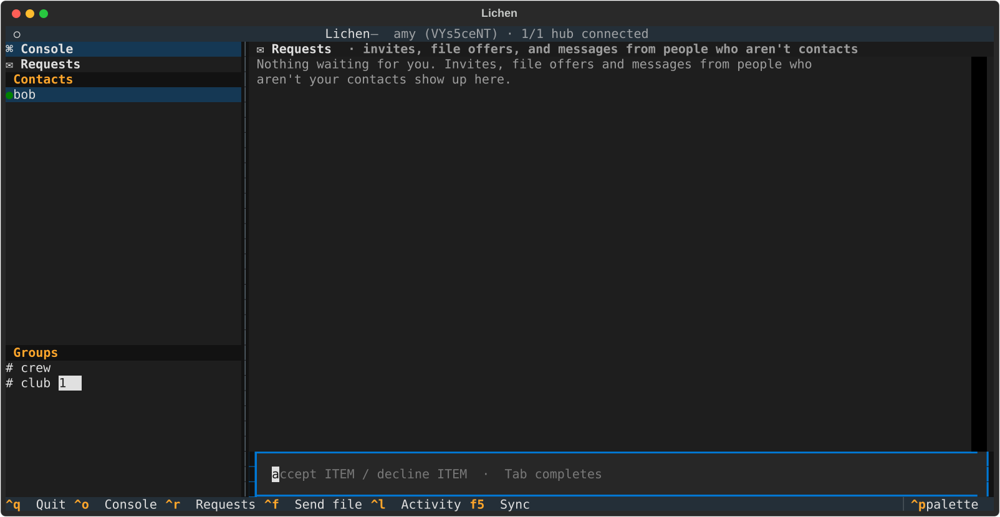

# Lichen

Prototype of a decentralized, end-to-end encrypted chat where everyone keeps a phonebook of everyone else.

- **You are your key.** Each node has an Ed25519 key (identity, signatures) and an X25519 key
  (encryption). The Ed25519 public key is who you are.
- **Records are signed.** A contact record says "this key lives at these addresses, and here's how to
  encrypt to it", with a sequence number, signed by that key. Anyone can store and forward records
  without being trusted; forgeries fail verification and stale records lose to newer `seq`.
- **Moving = gossip.** When your address changes you sign a new record and send it to everyone you
  know; anyone who learns something new forwards it on.
- **Find one person, reach everyone.** `hello` to any node returns its whole phonebook.
- **Phonebook server = just a node** at a public address: an IP/domain with an open port, or a
  `wss://` URL behind Cloudflare Tunnel or any HTTPS proxy. It introduces peers so they can connect
  **directly** (UDP hole punching), and relays for anyone whose network won't allow that.
- **Hubs federate.** Point one hub at another and their phonebooks merge; users on either can reach
  users on both.
- **Stale address?** If delivery fails, the sender asks its contacts and bootstrap nodes for a fresher
  record and retries.
- **Everything is end-to-end encrypted.** Relays and phonebooks only see ciphertext and who it's for.

## Install

Needs Python 3.11+. Straight from GitHub:

```powershell
pip install git+https://github.com/LegoManACM/Lichen
lichen --init     # writes a starter lichen.yaml; put your name and your hub in it
lichen            # run it
```

(`python -m lichen` works too.)

### From a checkout (for hacking on it)

PowerShell (Windows):

```powershell
python -m venv .venv
.\.venv\Scripts\Activate.ps1          # once per terminal; prompt shows (.venv)
python -m pip install -e .            # editable install: gives you the `lichen` command
```

If activation says scripts are disabled: `Set-ExecutionPolicy -Scope CurrentUser RemoteSigned`.
In cmd use `.venv\Scripts\activate.bat`; on macOS/Linux `source .venv/bin/activate`.
All commands below assume the venv is active.

## Terminal UI

Run it in a normal terminal and you get a full-screen app:



- **Sidebar:** your contacts (plus strangers who wrote to you, marked `?`) and groups (invites marked
  `✉ … (invite)`). `●` green = direct peer-to-peer path, `●` cyan = they accept connections directly
  (hubs, open ports), `◐` yellow = through their hub. A number badge shows unread messages.
- **Requests** (**Ctrl+R**): group invites, file offers and messages from people who aren't your
  contacts. Type `accept NAME` / `decline NAME` there (Tab completes).
- **Sending files:** **Ctrl+F** in a conversation opens a file picker (browse, or type/paste a path
  with Tab completion). Or drag a file into the terminal window: the path gets pasted into the box and
  Enter sends it. Offers and downloads show up inline in the chat, with live progress.
- **Console** (top of the sidebar, and where the app starts): a terminal for running commands, no
  slash needed (`help`, `peers`, `group create devs alice bob`, ...), with all their output kept.
  **Ctrl+O** jumps back to it from anywhere.
- **Pick a conversation** (arrow keys + Enter, or click) and just type; Enter sends. `/commands` work
  there too, with their output shown inline (and also kept in the console).
- **Autocomplete:** as you type a command, grey ghost text suggests the rest: command names, `/group`
  subcommands, contact names, group names, `private`/`shared`. **Tab** (or →) accepts it; a hint line
  above the box shows usage and what fits.
- **Ctrl+L** shows the activity pane (connections, hole punches, relay events), **F5** syncs (groups,
  chats, and anything waiting to be delivered), **Esc** jumps back to the message box, **Ctrl+Q** quits.
- Direct-message history is kept in `data/<name>/dms.json` (group history in `groups.json`).

`ui: tui` / `ui: cli` (or `--ui`) picks one explicitly. The default `auto` uses the full-screen UI in
an interactive terminal and the plain prompt when input is piped (scripts, tests).

## Config files

Every option can live in a YAML or JSON file, so day to day you just run:

```powershell
lichen                        # uses lichen.yaml / .yml / .json in this folder
lichen --config hub.yaml      # or a specific file
lichen --init                 # writes a commented starter lichen.yaml
```

Flags on the command line override the file. Options (same names as the flags):

| option      | what it does |
|-------------|--------------|
| `name`      | your display name (your key is your real identity) |
| `relay`     | hub(s) to receive messages through: `HOST:PORT`, `ws://...` or `wss://...`; a list = several hubs |
| `bootstrap` | list of nodes/hubs to fetch phonebooks from (the relay is added automatically) |
| `port`      | port to listen on, TCP and UDP (hubs; default 9000) |
| `host`      | public IP / DNS name others can reach you at directly (hub with an open port) |
| `bind`      | interface to listen on, e.g. `0.0.0.0` |
| `url`       | public address to advertise instead of host:port, e.g. `wss://chat.example.com` |
| `stun`      | STUN servers for learning your public UDP address (`[]` disables) |
| `data`      | where keys, phonebook and messages are stored (default `data/<name>`) |
| `ui`        | `tui`, `cli` or `auto` (default: full-screen UI in a real terminal) |
| `downloads` | where accepted files are saved (default `data/<name>/downloads`) |
| `max_file_mb` | refuse file offers bigger than this (default 100) |
| `auto_download_mb` | auto-accept files up to this size from your contacts (default 0 = always ask) |

Ready-made examples are in [examples/](examples): `friend.yaml`, `hub-open-port.yaml`,
`hub-cloudflare.yaml`, `local-test.json`.

## Try it locally

Self-checking demo (address changes, stale phonebooks, groups, key rotation, private history,
NAT'd nodes via relay, offline delivery via IOUs, hole punching, federated hubs, a WebSocket-only hub,
invites, trust, file transfer, chat sync,
forged records):

```powershell
python demo.py
```

Interactive on one PC, one terminal each:

```powershell
lichen --name hub --port 9000
lichen --name alice --relay 127.0.0.1:9000
lichen --name bob --relay ws://127.0.0.1:9000
```

(The hub accepts both raw TCP and WebSocket on the same port, so alice and bob can mix.)

Commands: `/peers`, `/msg bob hello`, `/whoami`, `/join ADDRESS`, `/move PORT`, `/quit`.
Groups: `/group create devs bob carol` (add `--shared` to let new members see old messages),
`/group history devs shared`, `/g devs hi all`, `/group add devs dave`,
`/group remove devs bob`, `/groups`, `/history devs`, `/sync`. `/help` lists everything.

State lives in `data/<name>/`: `key` and `enckey` are your private keys (don't share them),
plus `phonebook.json`, `groups.json`, and `mailbox.json` (messages held for others, if you're a relay).

## Using it over the internet

Only **one** machine needs to be reachable: the hub. Everyone else connects out to it, which works
behind any home router, mobile data, dorm or office network. Pick whichever way of hosting suits you:

### A. Cloudflare Tunnel (no port forwarding, home IP hidden)

The hub stays on `localhost`; `cloudflared` carries WebSocket traffic to it.

```powershell
cloudflared tunnel login
cloudflared tunnel create lichen
cloudflared tunnel route dns lichen chat.example.com
cloudflared tunnel run --url http://localhost:9000 lichen
```

```yaml
# hub.yaml   ->  lichen --config hub.yaml
name: hub
port: 9000
url: wss://chat.example.com
```

Friends use `relay: wss://chat.example.com`. To try it without a domain,
`cloudflared tunnel --url http://localhost:9000` prints a temporary `https://<random>.trycloudflare.com`
address; use it as `wss://<random>.trycloudflare.com` (it changes every time you restart cloudflared).
Any other HTTPS reverse proxy that passes WebSockets through (nginx, Caddy, ngrok, ...) works the same way.

### B. Open port (VPS, or your PC with a port forward)

Open or forward port 9000 for **TCP and UDP** (UDP lets the hub tell people their public address;
without it, public STUN servers are used instead). Allow Python through the firewall.

```yaml
name: hub
port: 9000
bind: 0.0.0.0
host: 203.0.113.7          # your public IP...
# host: chat.example.com   # ...or a domain pointing at it
```

Friends use `relay: 203.0.113.7:9000` (or `chat.example.com:9000`). For a home connection whose IP
changes, point a domain at it with dynamic DNS (DuckDNS, No-IP, or Cloudflare DNS in "DNS only" /
grey-cloud mode with an updater script).

### Everyone else

```yaml
name: yourname
relay: wss://chat.example.com     # or HOST:PORT, whatever the hub owner gave you
```

You'll get the hub's phonebook, show up in everyone else's, and can `/msg` anyone. Messages go
**directly between you and the other person** whenever your networks allow it; `/peers` shows
`[direct ip:port]` or `[via relay]` for each contact. If someone is offline, your message waits in
your outbox and goes out when you're both online (see [Offline delivery](#offline-delivery-ious)).
Windows may ask to allow Python on the network the first time; allow it, or direct connections can't
be made.

For redundancy, list several hubs: `relay: [wss://chat.example.com, other-hub.example.org:9000]`. You
attach to all of them, so you stay reachable if one goes down.

If you *can* accept connections yourself, add `host`/`bind`/`port` (or `url`) as well: people will
then try you directly first and only fall back to the relay.

### Several hubs

Give a hub `bootstrap: [<other hub address>]` (or run `/join <address>` on it) and the two phonebooks
merge both ways, then spread to everyone on each. People who join either hub later get the combined
phonebook, and can message and connect directly to anyone on any linked hub, whatever way each hub is
hosted. Actually *any* node that joins two hubs bridges them.

## Direct connections (hole punching)

Most people are behind a router (NAT) that blocks incoming connections. Lichen gets around it
the same way Tailscale and WebRTC do, with the hub only as an introducer:

1. Each node learns its public UDP address (the IP:port its router maps its socket to): from its hub's
   reply to a UDP ping if the hub has an open UDP port, otherwise from a public STUN server (Google,
   Cloudflare; configurable). Repeating this every 15 s keeps the router mapping open.
2. When you message someone through their relay, you also send them a small `punch` request the same
   way, carrying your public and local-network addresses; their reply carries theirs. Because it
   travels through the relay connection, this works for hubs behind Cloudflare and across hubs.
3. Both sides send UDP pings to every candidate address at once. Each router sees outgoing traffic to
   the other side and lets the replies in. The first signed reply from the right key is the direct path.
4. From then on, requests between you go peer to peer over UDP (chunked, with retransmits), with
   keepalive pings every 15 s. If a direct request fails, it falls back to the relay immediately,
   and punching is retried after a minute.

Works on most home routers and Wi-Fi, and on the same LAN. Often fails on carrier-grade NAT
(mobile data) and some corporate/university networks ("symmetric NAT"); those contacts stay
`[via relay]`, which still works, just through the hub.

## How relaying works

A node with `relay: ADDRESS` doesn't listen at all. It opens one outgoing connection to the relay
(raw TCP, or a WebSocket for `ws://`/`wss://`), proves it holds its key, and advertises its address
as `relay:ADDRESS`. To reach it, you send `{"type": "forward", "to": <key>, "msg": ...}` to the
relay, which pushes the request down that open connection and hands back the reply. So every
request type (messages, lookups, group sync, punch, file chunks) works through a relay. A keepalive
every 25 s stops proxies from closing it. If the node isn't connected, the hub doesn't store the
message: see the next section.

## Offline delivery (IOUs)

Hubs store as little as possible: **no messages, not even encrypted ones**, just IOUs.

1. You send something to someone who's offline (a message, a file offer, a group invite, a leave
   request). Their hub replies "they're away" and records an IOU: *you owe them item `<id>`*, plus a
   timestamp. If they use several hubs, each one gets the same IOU.
2. The item itself stays sealed in **your** `outbox.json`.
3. When they reconnect to any of their hubs, that hub tells them who owes them what ("alice has 1 thing
   for you") and **nudges** you to deliver. You also retry by yourself when their fresh phonebook record
   reaches you (they announce it on startup), every minute, on startup, and on `/sync`.
4. If you're offline when they come back, the IOU is redeemed when you're both online again.
   Unredeemed IOUs and outbox items expire after 30 days.

**Message ids.** Every direct message carries a random id chosen (and signed) by its author. Whatever
route a message takes (direct, relay, a retry, an IOU redeemed through two hubs at once) the
recipient keeps one copy, and conversations sort by time. **Chat sync** uses the same ids: on startup,
when someone comes back online, and on `/sync`, you and they swap "here are the ids I have" and each
sends what the other is missing (sealed, and checked against each author's signature), so gaps heal
themselves.

The trade-off: delivery needs you and the recipient online at the same time at some point; the hub
can't hand over anything on your behalf. Group chat already catches up from any member who's online,
so groups don't need IOUs.

## Trust, requests and invites

Every key is **trusted** (a contact), **unknown**, or **blocked** (`trust.json`):

- You trust someone by messaging them, sending them a file, accepting their request, or `/trust NAME`.
  `/untrust`, `/block` and `/unblock` do what they say.
- Messages from people who aren't your contacts arrive as **requests**: kept, listed in `/requests`
  (and the TUI's Requests view), no notifications. `/accept NAME` makes them a contact.
- **Blocked** keys are ignored completely: messages, file offers and group invites are dropped.
- **Group invites need accepting.** Being added to a group is an invite: you see who invited you and
  who's in it, but no messages until you `/accept GROUP`. `/decline GROUP` or `/group leave GROUP`
  sends the owner a signed leave request, and the owner's node removes you (rotating the group key).
- Pending invites, requests, offers and trust levels are saved, so nothing is lost across restarts.

### Hosting a group: handing it over or deleting it

The person who created a group is its **host**: only they can invite, remove, or change settings. The
host can't just leave; `/group leave GROUP` tells them to pick one of:

- **`/group leave GROUP NAME`**: hand the group to another member and leave. (`/group transfer GROUP
  NAME` hands it over but stays a member.) The host signs "the owner is now NAME" and sends NAME a sealed
  hand-over with the group's key history (needed to give future members the right keys). NAME's node
  then republishes the group as host with a fresh key, minus the old host if they left. If NAME is
  offline, the hand-over waits in the outbox like anything else.
- **`/group delete GROUP`**: a final signed "deleted" update; members' nodes forget the group's
  messages and keys (best effort: an honest client deletes, a modified one could keep a copy).

Ownership is verifiable by anyone: the group id is derived from the founder's key, and the record
carries the chain of hand-overs, each signed by the previous host. A member who joins long after a
hand-over can still check it, and nobody can claim a group they weren't handed.

## File sharing

`/send NAME PATH` (or `/send #group PATH`, or Ctrl+F / drag-and-drop in the TUI) offers a file:

1. Your node hashes the file and sends each recipient an **offer**, sealed to them: name, size,
   SHA-256, and a random per-file key. Nothing else moves yet.
2. They decide: `/accept NAME` or `/decline NAME`. Offers from strangers wait in requests; blocked
   senders' offers are dropped; anything over `max_file_mb` is refused automatically. With
   `auto_download_mb` set, small files from **contacts** download by themselves.
3. Accepting pulls the file in 48 KB chunks, each encrypted with the per-file key (bound to its
   offset), over the direct peer-to-peer path when there is one and the relay otherwise. Relays only
   ever see ciphertext.
4. Interrupted downloads resume where they stopped (`/accept` again). The finished file must match the
   SHA-256 from the offer, then lands in `downloads/` under a safe name that never overwrites anything.

The sender has to be online while you download (files aren't stored on hubs). `/files` lists
everything offered and received.

## Encryption

- **Direct messages** are signed by the sender, then sealed to the recipient's X25519 key (ephemeral
  X25519 + HKDF-SHA256 + ChaCha20-Poly1305). The relay sees the recipient's key and nothing else.
- **Groups** use a shared key per *epoch*. Every change (create, add, remove, history setting)
  starts a new epoch with a fresh random key, which the owner seals to each member individually
  inside the signed group record. Removed members never get the new key, so they can't read
  anything sent after their removal.

## Groups

- A group is a signed member list owned by its creator. Its id is `hash(owner key, nonce)`, so no one
  else can publish records for it. Changes = owner signs a new record with a higher `seq`.
- **Sending:** the message is signed by its author, encrypted with the current epoch key, and sent to
  every member directly (or via their relay).
- **Catching up:** every member keeps the group's encrypted log. On startup and on `/sync`, you send
  the other members the ids you already have, and they reply with what you're missing. Any member can
  fill the gap. Newly added members pull the history the same way.
- Receivers only accept messages that decrypt, verify, and come from a current member.

### History setting

`/group create devs bob carol` makes a **private-history** group (the default): people added later
only see messages from when they joined. `/group create devs --shared bob carol` lets new members
catch up on everything sent while the group was shared. The owner can switch with
`/group history devs private|shared`.

This is enforced by **cryptography**, not just politeness: a member only ever receives the keys for
epochs that started after they joined, plus (while the group is shared) the keys of epochs that were
shared. Private-era messages are unreadable to later joiners even if someone hands them the
ciphertext. Switching to `shared` and then adding someone doesn't expose anything said while the
group was private. Removing and re-adding someone gives them a new join time.

## Wire protocol

One connection per request (except `attach`, which stays open), either raw TCP with one JSON object
per line, or a WebSocket with one JSON object per text message. Servers accept both on the same port.

| type           | request                                  | reply                     |
|----------------|------------------------------------------|---------------------------|
| `hello`        | `{record}`                               | `{record, records[]}`     |
| `announce`     | `{record, from}`                         | `{ok}`                    |
| `lookup`       | `{pubkey}`                               | `{record \| null}`        |
| `msg`          | `{to, sealed}`                           | `{ok}`                    |
| `forward`      | `{to, msg, from, item}`                  | the target's reply, or `{ok, queued, iou}` |
| `attach`       | `{req: {pubkey, ts}, sig}` then stays open | `{ok}`, then `{rid, msg}` / `{rid, reply}` frames |
| `group_msg`    | `{envelope, group}`                      | `{ok}`                    |
| `group_update` | `{group}`                                | `{ok}`                    |
| `group_sync`   | `{req: {group, from, ts, have[]}, sig}`  | `{group, messages[]}`     |
| `punch`        | `{peer, addrs[]}` (usually via `forward`) | `{addrs[]}`; both sides then ping each other |
| `group_leave`  | `{req: {group, from, ts}, sig}`          | `{ok}`; the owner removes the member |
| `dm_sync`      | `{req: {from, to, ts, have[]}, sig}`     | `{sealed: {messages[]}}`  |
| `file_offer`   | `{to, sealed}`                           | `{ok}`                    |
| `file_get`     | `{file_id, offset}`                      | `{n, ct}` (one encrypted chunk) |
| `nudge`        | `{peer}` (hub -> sender)                 | `{ok}`; sender delivers what it owes `peer` |
| `owed`         | `{from: {sender: [item ids]}}` (hub -> recipient) | `{ok}` |

Over UDP, every request above can also travel on a punched path. Datagrams are JSON:
`ping`/`pong` (signed; pong reports the address it saw), and `req`/`rep` chunks
`{id, i, n, d}` that reassemble into the same request/reply objects as over TCP.

## Not done yet (prototype limits)

- **Not security-reviewed.** The crypto uses standard building blocks from `cryptography`, but the
  protocol around them hasn't been audited. Don't rely on it for anything sensitive yet.
- **No forward secrecy for direct messages:** if someone steals your `enckey` file, they can decrypt
  past direct messages they recorded. (Groups are better: old epoch keys don't decrypt new epochs.)
- **Contact records aren't encrypted:** the phonebook reveals everyone's name, key and addresses
  (including direct IPs for nodes that advertise one) to everyone.
- **Spam / abuse:** anyone can join a hub and flood the phonebook with fake identities. Strangers'
  messages and offers only land in requests, and you can block, but there's no rate limiting yet.
- **Gossip floods to everyone:** O(N²) messages per change; fine for hundreds of nodes, not millions.
- **Hubs matter for reachability:** finding people, introductions and relayed traffic go through them.
  Direct paths that already exist keep working if a hub goes down, and listing several hubs in
  `relay` keeps you reachable when one fails.
- **Offline delivery needs an overlap:** with IOUs nothing is stored on hubs, so a message only arrives
  once sender and recipient have both been online at the same time. Outbox retries need the recipient's
  address to be findable; senders retry roughly once a minute and ask everyone they know for a fresh
  record each time, which is chatty with very large phonebooks.
- **STUN servers see your IP.** With a WebSocket-only hub, your node asks Google's/Cloudflare's STUN
  servers for its public address every 15 s. Set `stun: []` to opt out (you'll still connect directly
  on the same LAN, and via relay otherwise), or point it at a STUN server you trust.
- A hub behind Cloudflare means Cloudflare can see relayed traffic metadata (who's attached, sizes,
  timing), though not message contents, which are end-to-end encrypted.
- **No IPv6** yet for direct paths (UDP is IPv4 only), and no port prediction for symmetric NATs.
- **Direct connections reveal IPs:** a peer you connect to directly learns your public IP, and
  introductions share your local-network addresses with them.
- UDP transfers are simple stop-and-wait chunks with no congestion control: fine for chat, slow for
  very large catch-up syncs over lossy links.
- Group catch-up only happens on startup and `/sync`, not continuously.
- Removing a member also drops their old messages from catch-up for anyone who syncs later.
- Only the host can change a group, from the device with their key. They can hand it over, but if
  they vanish without doing so, the group can't change membership any more.
- Groups saved by versions before encryption are ignored (contacts are kept).
- Join times come from the owner's clock and message times from the author's; a big clock difference
  only matters for which ciphertexts are offered during catch-up, not what can be decrypted.
