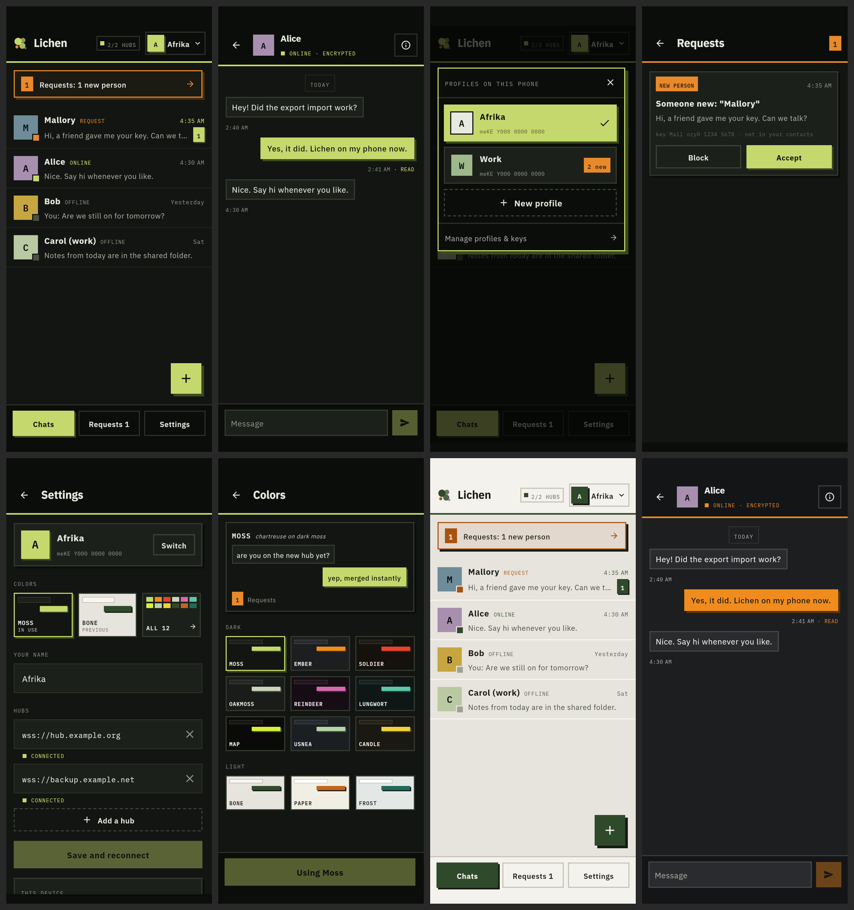

# Lichen Android: the Slab design

The app's look is **Slab**: a dark ground, square corners, 2dp borders and hard drop shadows with no blur.
It comes from the *Lichen Mobile* design canvas: <https://claude.ai/artifact/8geu6UpVrCaeTrhnMYSXZM>
(screens `project/Slab*.dc.html`, palettes `project/PaletteLab.dc.html`).

Code lives in `app/src/main/java/dev/lichen/app/ui/theme/`:

| File | What's in it |
| --- | --- |
| `Palette.kt` | `LichenPalette` and the 12 palettes (`LichenPalettes.all`) |
| `PaletteChoice.kt` | The palette in use plus the one before it; `ThemePrefs` persists both |
| `Theme.kt` | `LichenTheme`, `LocalLichenPalette` / `Slab.colors`, the fonts, the Material 3 mapping |
| `Components.kt` | `hardShadow`, `slabBorder`, `dashedBorder`, `SlabTopBar`, `SlabBottomBar`, `SlabButton`, `SlabIconButton`, `SlabCard`, `SquareAvatar`, `MonoTag`, `SectionLabel`, `SlabSwitch`, `slabFieldColors`, `LichenMark` |

## Tokens

Every palette has the same ten base tokens, copied exactly from the canvas, plus three alert tokens:

| Token | Used for | Moss (default) |
| --- | --- | --- |
| `ground` | screen background | `#121511` |
| `bar` | top and bottom bars, popovers, and the shadow under cards | `#0B0D0A` |
| `card` | cards, their message bubbles, inputs | `#1C201A` |
| `edge` | 2dp borders | `#343B30` |
| `text` | text | `#E6EADF` |
| `muted` | timestamps, meta, section labels | `#8E9787` |
| `accent` | primary buttons, my bubbles, the rule under top bars, the selected nav item | `#C5D86D` |
| `onAccent` | text on accent | `#0B0D0A` |
| `shadow` | hard shadow under accent things | `#3B4A1E` |
| `alert` | requests, warnings | `#E8892B` |
| `onAlert` / `alertShadow` | text on alert, shadow under alert cards | `#1C1813` / `#4A2E12` |

The derived shades are computed from those (`LichenPalette` getters), so a new palette only needs the base tokens:
`subtle` (previews and card bodies), `dim` (keys under a card body), `line` (borders on the bars),
`strongLine` (outline of secondary buttons), `alertGround` (background of alert-bordered cards) and `off`
(the badge of an offline contact).

### The 12 palettes

| Dark | Dark | Dark | Light |
| --- | --- | --- | --- |
| MOSS: chartreuse on dark moss | REINDEER: magenta | CANDLE: yolk yellow | BONE: deep moss on pale stone |
| EMBER: orange on grey bark | LUNGWORT: teal-green | | PAPER: rust on warm paper |
| SOLDIER: red caps | MAP: acid yellow on black | | FROST: pine on mint-grey |
| OAKMOSS: grey-green on bark | USNEA: sage on slate | | |

Moss is the default. Exact hexes are in `Palette.kt`. To add a palette, add it there and to `all`; the picker
and the "ALL n" tile pick it up on their own.

### Choosing a palette

Settings → COLORS shows three tiles: the palette **IN USE**, the **PREVIOUS** one (tap it to swap back, and
tap again to swap forward), and **ALL 12**, which opens the Colors screen. That screen has a live preview
card in the picked palette's own colors, a DARK grid and a LIGHT grid, and a **Use X** button. The choice is
saved in the `lichen_ui` SharedPreferences (`palette`, `palette_previous`), next to the other UI flags. It is
per phone, not per profile.

## Shapes

- **No rounded corners anywhere.** `LichenTheme` gives Material a `Shapes` with every size at 0dp radius, so
  text fields, cards, dialogs and sheets come out square. Material components whose shape is hard-wired to a
  pill (`Button`, `FilledIconButton`, `Switch`, `Badge`, chips) aren't used: use `SlabButton`,
  `SlabIconButton`, `SlabSwitch` and `MonoTag` instead.
- **Borders are 2dp** (`Modifier.slabBorder`). The only 1dp ones are the day chip in a chat and the bars in
  palette tiles.
- **Shadows are hard offsets with no blur** (`Modifier.hardShadow(color, offset)`): the same rectangle in a solid
  color, moved right and down. Put it *before* `background` in the modifier chain, and leave room for it
  (about 4dp of end padding on lists of cards).

| Thing | Shadow |
| --- | --- |
| Primary button, nav item, send button, unread tag | 3dp `shadow` |
| My message bubble, primary card buttons, requests banner | 4dp `shadow` (banner: `alertShadow`) |
| Cards (requests, settings blocks, dialogs) | 4dp `bar` |
| FAB | 5dp `shadow` |
| Profile switcher panel | 6dp `shadow` |

## Type

IBM Plex Sans and IBM Plex Mono, bundled in `res/font` (SIL Open Font License; see
`licenses/IBM-Plex-OFL.txt`). Weights: Sans 400/500/600/700, Mono 400/500/600.

- **Sans** for anything you read: names (Bold 16sp in lists, 17sp in the chat header), titles
  (Bold 21sp in the top bar), body text 14–15sp, and buttons (Bold for primary, SemiBold for others).
- **Mono** for anything that's meta: timestamps (11sp), connection tags (`ONLINE`, `REQUEST`; 10sp,
  +0.08em), section labels (10sp, +0.14em, upper case, `muted`), keys and fingerprints, counts, and
  palette names. Material's `labelMedium`/`labelSmall` are mono.

## Components

- **Top bar** (`SlabTopBar`): `bar` background under the status bar, then a **3dp accent rule**. Requests
  uses `alert` for the rule. The back button is borderless; header actions (chat info) are 44dp squares
  with a 2dp `line` border.
- **Bottom bar** (`SlabBottomBar`): `bar` background with a 2dp `line` on top. Home has the 3-way nav
  (Chats / Requests / Settings): the current item is filled accent with a 3dp shadow, the others outlined.
- **Buttons** (`SlabButton`): *Primary* is filled accent with `onAccent` text and a hard shadow. *Secondary*
  is transparent with a 2dp `strongLine` outline. *Card* is card-filled with an edge border. *Danger* is
  outlined in the error color. *Dashed* is a dashed outline, for "add another" actions. Disabled buttons are
  at 40% opacity with no shadow.
- **Avatars** (`SquareAvatar`): squares with a mono initial in dark text on one of six mid-tone tints
  (picked from the key). In lists, a **connection badge** square sits on the bottom-right corner, ringed
  in `ground`: accent when online, alert for a request, `off` when offline. The same state shows as a
  mono tag next to the name.
- **Chat bubbles** are sharp. *Theirs*: `card` fill with a 2dp `edge` border. *Mine*: `accent` fill with
  `onAccent` text and a 4dp hard `shadow`. The time and state (`READ`, `DELIVERED`, …) sit in mono under
  each bubble, not inside it. A bordered mono chip (`TODAY`, `YESTERDAY`, `MON 6 OCT`) marks each new day.
- **Cards** (`SlabCard`): `card` fill, 2dp `edge`, 4dp `bar` shadow. Alert cards (the requests banner) use
  `alertGround` with a 2dp `alert` border and an `alertShadow` shadow.
- **Profile switcher**: a panel that drops down under the top bar over a dark scrim (not a bottom sheet):
  `bar` background, 2dp accent border, 6dp shadow. The active profile is a filled accent tile with a check;
  the others are card tiles with an alert "N new" tag. Then a dashed **New profile** button and a
  "Manage profiles & keys" row.
- **Text fields**: `OutlinedTextField` with `slabFieldColors()`: card fill, edge border, accent when focused.
  Hub addresses are in mono.
- **Toggles** (`SlabSwitch`): a square track. When on, it's accent with a dark knob; when off, outlined with a muted knob.
- **Status bar icons** follow the palette (dark icons on Bone, Paper and Frost).

## Screens without a mockup

These follow the same rules: contact info (key blocks as cards, a trust section), Manage profiles, onboarding
(the mark and wordmark, two choice cards), the debug log (mono on `bar`), and the delete-profile dialog (a
card with a Danger button). "Add someone" keeps the app's phonebook search under the mockup's "your key" card;
there is no QR code yet, so the card shows your name and fingerprint, with Copy key and Share key buttons.
